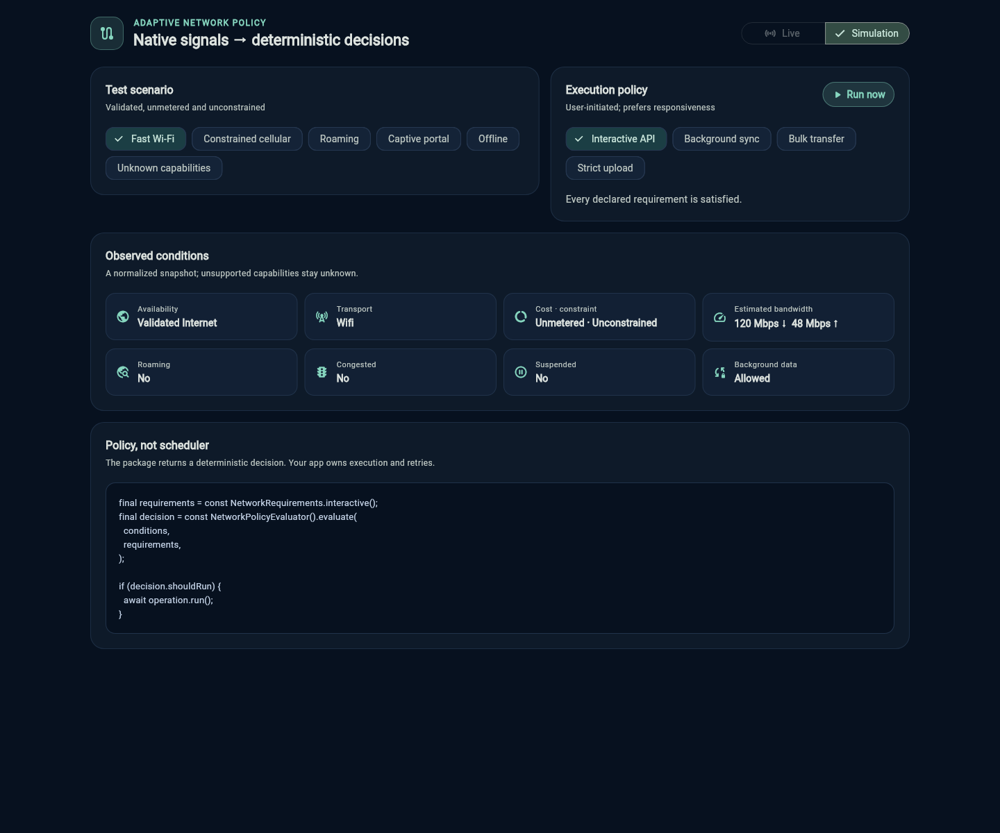
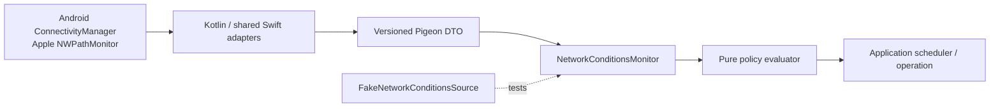

# adaptive_network_policy

[](https://github.com/wasiliy-strecker/adaptive_network_policy/actions/workflows/ci.yml)
[](LICENSE)
[](https://flutter.dev)

Native network conditions and deterministic execution policies for Flutter apps
on Android, iOS, and macOS.

Most connectivity APIs answer “is there a network?”. Real applications also
need to decide whether *this operation* should run on a metered, constrained,
roaming, congested, captive, or background-restricted path.
`adaptive_network_policy` keeps those concerns separate:

- a normalized, immutable snapshot of native network conditions;
- a deduplicated stream of semantic changes;
- a pure policy evaluator with typed allow/defer reasons;
- presets for interactive work, background sync, and bulk transfers;
- a controllable fake source for deterministic tests;
- typed Pigeon channels with Kotlin and shared Swift implementations.



The package does not schedule work, retry requests, or claim that a particular
server is reachable. Your application remains in control of execution.

> Version 0.1.0 is currently an unpublished preview. `publish_to: none` stays in
> place until the first release checklist has been completed.

## Quick start

Until the package is published, depend on the repository:

```yaml
dependencies:
  adaptive_network_policy:
    git:
      url: https://github.com/wasiliy-strecker/adaptive_network_policy.git
      ref: main
```

Observe native conditions:

```dart
final monitor = NetworkConditionsMonitor();

final current = await monitor.current();
final subscription = monitor.changes.listen((conditions) {
  print('${conditions.availability} via ${conditions.transports}');
});

// Cancel with the lifecycle of the owning service or widget.
await subscription.cancel();
```

Evaluate an operation without side effects:

```dart
const evaluator = NetworkPolicyEvaluator();
const requirements = NetworkRequirements.bulkTransfer();

final decision = evaluator.evaluate(current, requirements);
switch (decision) {
  case NetworkAllowed():
    await upload.run();
  case NetworkDeferred(:final reasons):
    log.info('Upload deferred: $reasons');
}
```

Unknown native capabilities are permissive by default because platforms expose
different signals. Critical work can opt into conservative handling:

```dart
final requirements = const NetworkRequirements.bulkTransfer().copyWith(
  requiresValidatedInternet: true,
  unknownCapabilityBehavior: UnknownCapabilityBehavior.defer,
);
```

## Deterministic tests

Test the same application code without platform channels:

```dart
final fake = FakeNetworkConditionsSource(NetworkConditions.unknown());
final monitor = NetworkConditionsMonitor(source: fake);

fake.emit(
  NetworkConditions.unknown().copyWith(
    availability: NetworkAvailability.validatedInternet,
    cost: NetworkCost.metered,
  ),
);
```

Import test helpers separately so they do not expand the primary API:

```dart
import 'package:adaptive_network_policy/testing.dart';
```

## Platform support

| Signal | Android | iOS / macOS |
| --- | --- | --- |
| Availability | active path, internet capability, validation, captive portal | `NWPath` status; satisfied paths are `internetConfigured` |
| Transport | Wi-Fi, cellular, Ethernet, VPN, other | Wi-Fi, cellular, Ethernet, loopback, other |
| Transfer cost | metered, unmetered, temporarily unmetered | `isExpensive` |
| Data constraint | bandwidth constraint on API 36+ | Low Data Mode via `isConstrained` |
| Roaming / congestion / suspension | native capabilities on API 28+ | `unknown` |
| Background data | Android Data Saver status | `unknown` |
| Link bandwidth | OS link estimate when reported | `unknown` |

Minimum targets are Android 24, iOS 13, and macOS 10.15. Android declares only
the normal `ACCESS_NETWORK_STATE` permission. The plugin performs no probe
requests and collects no user data.

See [platform semantics](doc/platform-semantics.md) before using a signal for a
critical decision.

## Architecture



Native adapters only normalize operating-system facts. The Dart monitor owns
deduplication and typed errors. The policy layer is pure Dart and knows nothing
about channels or app lifecycle. See [architecture](doc/architecture.md) for
the design boundaries.

## Interactive example

The example is both a native live monitor and a scenario-driven policy lab:

```sh
cd example
flutter run -d chrome
```

Web intentionally uses simulation because the plugin's runtime implementation
targets Android, iOS, and macOS. On those native platforms the demo can switch
between live conditions and the same deterministic scenarios.

## Development

```sh
make get
make generate
make check
```

The equivalent individual commands are documented in the
[contribution guide](CONTRIBUTING.md). Generated channel code is checked in so
consumers do not need Pigeon.

## Scope and guarantees

- A positive network decision is permission to *attempt* work, not a guarantee
  that DNS, TLS, an endpoint, or authentication will succeed.
- Bandwidth values are operating-system estimates, not throughput measurements.
- Capability changes can race with requests. Network failures still need normal
  timeout, retry, and idempotency handling.
- `unknown` is preserved instead of inventing parity across platforms.

Release steps live in [doc/releasing.md](doc/releasing.md). This project is
available under the [MIT License](LICENSE).
