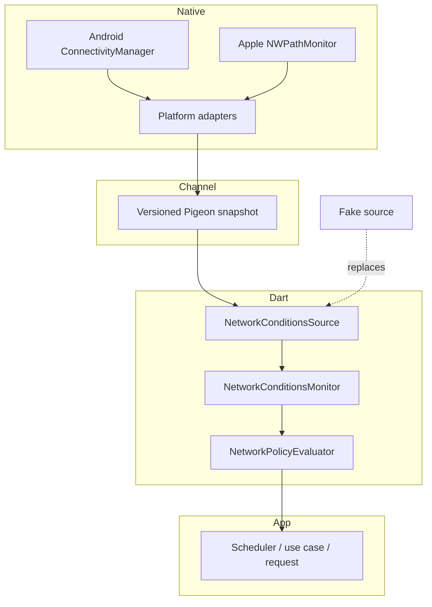

# Architecture

## Design goal

The package answers one narrow question: given facts the operating system can
report, should a declared network-dependent operation start now or defer?

It intentionally separates observation, normalization, policy, and execution.

## Boundaries

### Native adapters

Kotlin and shared Swift code read native state and map it to one schema. They do
not decide whether an application's work is important enough to run. Native
callbacks are released when the Dart event subscription is cancelled or the
Android engine detaches.

### Typed channel

Pigeon generates the host API, event API, codecs, and data transfer objects.
`schemaVersion` gives the Dart decoder an explicit compatibility guard. Invalid
timestamps or bandwidth values are rejected as typed monitor failures.

### Monitor

`NetworkConditionsSource` is the dependency-inversion seam. The native source
and fake source implement the same contract. `NetworkConditionsMonitor`
deduplicates observations whose only difference is timestamp, preventing path
callback noise from becoming application work.

### Policy

`NetworkPolicyEvaluator` is synchronous, pure, and stateless. It evaluates all
requirements so a deferred result contains the complete set of blocking
reasons. It never invokes a callback, starts a job, or waits for a better path.

### Application

The consuming app owns lifecycle, cancellation, persistence, retries,
idempotency, and background-execution APIs. This boundary prevents a network
utility from becoming an implicit task scheduler.

## Error model

Platform and channel failures are translated into `NetworkMonitorException`
with stable codes:

- `unsupportedPlatform`
- `permissionDenied`
- `invalidNativeData`
- `nativeFailure`

Policy deferrals are values, not exceptions. No network path is an expected
state and therefore maps to `NetworkDeferred`.

## Concurrency

Android callbacks may originate outside the Flutter thread and are marshalled
to the main looper before emitting. `NWPathMonitor` runs on a private serial
queue; snapshots are protected by a lock and event delivery returns to the main
queue. Dart exposes immutable snapshots and a deduplicated stream.

## Non-goals

- endpoint reachability or internet probe traffic;
- request retries, queues, or durable scheduling;
- bandwidth measurement;
- pretending that every OS exposes identical facts;
- web, Linux, or Windows native implementations in 0.1.x.
